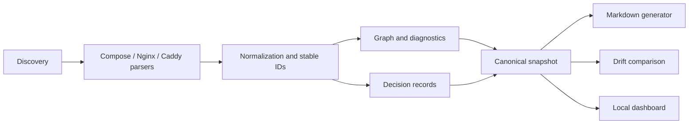

<p align="left">
  
</p>

# InfraJournal

**Your infrastructure, automatically documented.**

InfraJournal reads the configuration files you already maintain — Docker
Compose, Nginx and Caddy — and turns them into a stable infrastructure
inventory: services, networks, volumes, domains, endpoints, dependencies,
warnings and architecture decision records. It is local-first, deterministic
and read-only by design. It does not need a Docker daemon, cloud credentials or
network access.

> **Project status (0.1.0, pre-release).** The scanner, CLI, Markdown
> generator, drift command and local dashboard are implemented and exercised
> against the bundled examples. The package has not been published to npm.

## The problem

Infrastructure knowledge is scattered across Compose files, proxy
configuration, backup notes and decisions that live in someone's head. Diagrams
go stale, onboarding takes days, and nobody is sure which service is actually
public.

InfraJournal builds the documentation from those files instead of asking you to
maintain a second copy. Parsed facts carry source locations and evidence, so you
can see why something is in the inventory. Inferred links are labelled as
inferred. Missing backup policies are reported as findings, not silently
assumed.

## Features

Available in the core scanner today:

- **Docker Compose inventory** — services, images and builds, ports, named and
  bind mounts, networks, `depends_on`, healthchecks, environment *key names*,
  `env_file` references and labels.
- **Nginx subset** — `server` blocks, literal `server_name`s, `location` paths,
  `proxy_pass`, `upstream` blocks, TLS presence.
- **Caddy subset** — site addresses, `reverse_proxy` targets, basic matchers,
  `handle`/`handle_path` paths, TLS presence.
- **Deterministic graph** — services, networks, volumes, domains, endpoints and
  external upstreams with typed edges and evidence.
- **Stable IDs and snapshots** — content-addressed JSON with relative POSIX
  paths, canonical ordering and a versioned schema (`1.0.0`).
- **Diagnostics** — 44 stable codes (`IJ001`–`IJ044`) covering parse failures,
  unresolved references, exposure, duplicate ports and missing backup policies.
- **Decision records** — optional YAML ADRs linked to the services they affect.
- **Read-only discovery** — size, depth and file-count limits; symlink escape
  protection; never follows includes or reads environment values.
- **Three validated examples** — simple stack, Caddy reverse proxy and a
  multi-service Compose + Nginx stack with ADRs.

Shipped in 0.1.0:

- `infrajournal` CLI with `init`, `scan`, `generate`, `check` and `ui`.
- Markdown documentation generation with preservation of hand-edited files.
- Snapshot drift comparison with stable exit codes.
- Local-only dashboard for the graph, services, storage, domains and warnings.

## Install

**From source (available now).** Node.js 22.12 or newer and pnpm 12 are
required.

```bash
git clone <repository-url> infrajournal
cd infrajournal
corepack enable
pnpm install
pnpm build
node packages/cli/dist/index.js --version
```

To put the command on your `PATH` while working from source:

```bash
pnpm --filter infrajournal link --global
infrajournal --version
```

**From npm (intended after the first publish).** The package is **not yet
published**. Once it is, the intended installation is:

```bash
npm install --global infrajournal
# or run without installing:
npx infrajournal --help
```

## 60-second quickstart

The multi-service example is a realistic stack: Nginx in front of a web app and
worker, PostgreSQL, Redis, three named volumes and three ADRs. It contains no
runnable secrets.

```bash
cd examples/multi-service

# Scan only; prints a summary and writes nothing.
node ../../packages/cli/dist/index.js scan

# Generate Markdown documentation and a snapshot baseline.
node ../../packages/cli/dist/index.js generate

# Compare the current scan with the generated snapshot.
node ../../packages/cli/dist/index.js check

# Explore the graph and findings in a local dashboard.
node ../../packages/cli/dist/index.js ui
```

Expected from the current core scanner: 5 services, 2 networks, 3 volumes,
2 domains, 18 dependency edges and 4 informational findings (Nginx publishes
host ports; the three named volumes have no documented backup policy). The scan is
read-only.

With a global install, replace `node ../../packages/cli/dist/index.js` with
`infrajournal`.

## CLI examples

### Scan and summarize

```bash
# Human-readable summary on stdout.
infrajournal scan

# Machine-readable snapshot only on stdout (no banner or logs).
infrajournal scan --format json | jq '.stats'
```

Expected JSON shape (a real excerpt of the multi-service result, reduced with
`jq`; keys are shown in canonical order):

```json
{
  "dependencies": 18,
  "domains": 2,
  "endpoints": 2,
  "files": 5,
  "networks": 2,
  "services": 5,
  "volumes": 3,
  "warnings": { "error": 0, "info": 4, "warning": 0 }
}
```

`scan --format json` emits the snapshot object described in
[docs/architecture.md](docs/architecture.md). It never writes files unless
`--output <file>` is given.

### Generate documentation

```bash
infrajournal generate
```

Writes Markdown and `snapshot.json` under `output.directory` (default
`./infra-docs`). Generated files carry a marker; files without the marker are
preserved, so hand-written notes are not overwritten. The exact generated file
list is documented in [docs/configuration.md](docs/configuration.md).

### Detect drift

```bash
infrajournal check
```

With no drift the command exits `0`. If the current scan differs from the
baseline, it reports added, removed and changed resources and exits `3`. A
missing baseline exits `4`; configuration/usage errors exit `2`; unexpected
runtime failures exit `1`. `check` never rewrites the baseline.

```bash
# Refresh the baseline deliberately, then review it like any other change.
infrajournal generate
infrajournal check --format json | jq '.summary'
```

### Start the local dashboard

```bash
infrajournal ui            # scans, serves http://127.0.0.1:4173/
infrajournal ui --port 8080
```

The server binds to `127.0.0.1` only. If the default port is busy it tries the
next 20 ports and prints the chosen URL; an explicitly requested busy port is an
error. The dashboard requires a built web bundle (`pnpm build`).

## Dashboard preview

There is no checked-in screenshot yet. Run `infrajournal ui` against
`examples/multi-service` and open the printed localhost URL to view the graph,
resource tables and warnings. A real screenshot may be added under
`docs/assets/` after the dashboard build is integrated; this README does not
include fabricated imagery.

## Supported configuration

| Input | Detected by default | Supported subset |
| --- | --- | --- |
| Docker Compose | `compose.yml`, `compose.yaml`, `docker-compose.yml`, `docker-compose.yaml` | Single-file Compose services, ports, volumes, networks, `depends_on`, healthcheck, restart, environment keys, `env_file` paths, labels |
| Nginx | `**/nginx/*.conf`, `**/nginx/**/*.conf` | `server`, literal `server_name`, `location`, literal `proxy_pass`, `upstream`, TLS presence |
| Caddy | `Caddyfile`, `Caddyfile.*` | Site addresses, `reverse_proxy`, basic path matchers, `handle`/`handle_path`, TLS presence |
| Decisions | `*.yml` / `*.yaml` under `decisions.directory` | `id`, `title`, `status`, `date`, `context`, `decision`, `consequences`, `related_services` |

Add paths in `scan.include` if your files use other locations. Include patterns
and exclusion semantics are documented in
[docs/configuration.md](docs/configuration.md). Anything outside the subsets is
reported as a warning where the parser can recognize it, and ignored otherwise.

## Limitations

| Area | Limitation |
| --- | --- |
| Compose | No interpolation, variable resolution, multi-file merging, `include`, `extends` resolution, profiles, `configs`, or `secrets` contents. |
| Compose | `network_mode` is reported but not modeled; unknown fields are ignored. |
| Nginx | `include` is not followed, `map` is not evaluated, variables are not resolved, `if` conditions and regex locations are not evaluated. |
| Caddy | `import` is not followed; plugins and directives outside the documented subset are not interpreted. Placeholders and Unix sockets are skipped. |
| Inference | Environment-key inference is a heuristic based on key names and unique matches. It is not proof of a runtime dependency. |
| TLS | TLS is recorded only when configuration declares it. Certificates are never validated. |
| Runtime | No Docker daemon, container state, DNS, firewall or cloud resources are inspected. |
| Backups | A missing backup policy is a documentation finding, not proof that no backup exists. |
| Security | Redaction is best-effort. Generated snapshots can still contain sensitive topology, image names and decision text; review before publishing. |

Full details and residual risks: [docs/limitations.md](docs/limitations.md).

## Architecture overview



The core pipeline is deterministic: given the same inputs, IDs, ordering,
resource content and `contentHash` are stable. Only `metadata.generatedAt`
varies. See [docs/architecture.md](docs/architecture.md) for the package map,
ID strategy, snapshot versioning, drift algorithm and threat boundaries.

## Security and privacy

InfraJournal is local-first and read-only. It does not execute scanned files,
start containers, contact registries or send telemetry. It reads only matched
files inside the scan root; symlinks that escape the root are skipped.
Environment **values**, `env_file` contents, Compose secret files and the
contents of bind-mounted host paths are never read or stored. Environment
variable names and label names are retained; label values are not (backup
policy labels are the exception). Diagnostics and CLI errors pass through
best-effort secret redaction.

These guarantees reduce exposure but are not absolute. Generated documentation
can reveal internal hostnames, ports and architectural detail. Review output
before committing or publishing it. See [SECURITY.md](SECURITY.md) for the
threat model and reporting process.

## Roadmap

**Shipped (0.1.0 core)**

- Schema-versioned snapshot and config contracts.
- Deterministic Compose, Nginx and Caddy scanning.
- Stable graph, evidence, diagnostics and decision records.
- Example stacks and source-level validation.

**P0 — first release**

- `init`, `scan`, `generate`, `check`, `ui` CLI commands.
- Markdown generator and baseline `snapshot.json`.
- Drift report with exit codes 0/1/2/3/4.
- Localhost-only dashboard.
- Packaged CLI with bundled web assets.

**P1 — next (candidates, not committed)**

- Compose multi-file and `include` merging.
- Compose `extends` resolution.
- Optional Nginx `include` following inside the scan root.
- Caddy `import` following inside the scan root.
- Richer proxy matcher support and attached upstream health metadata.
- Additional export formats driven by the same snapshot contract.

**P2 — exploratory**

- Pluggable parsers for other reverse proxies and infrastructure formats.
- Historical drift reports and CI annotations.
- Read-only connectors for runtime inventory, only with explicit opt-in.

Roadmap items are not available until they are marked shipped in the release
notes. No runtime or hosted service is required by the roadmap.

## Contributing

Contributions are welcome. Start with [CONTRIBUTING.md](CONTRIBUTING.md), which
covers the pnpm workspace, verification commands, parser rules and pull request
expectations. Please follow the [Code of Conduct](CODE_OF_CONDUCT.md) and report
security issues privately as described in [SECURITY.md](SECURITY.md).

## License

MIT. See [LICENSE](LICENSE).

---

**Project status**

| Area | State in this checkout |
| --- | --- |
| Core scanner, parsers, graph, diagnostics, decisions, snapshot | Implemented |
| Examples | Implemented and validated against the core scanner |
| CLI (`init`, `scan`, `generate`, `check`, `ui`) | Interface documented; integration in progress |
| Markdown generator and drift engine | Contract documented; implementation in progress |
| Dashboard | Implemented; run `pnpm build` then `infrajournal ui` |
| npm package | Not published; install from source |

When the CLI and generator integration lands, the commands in this README
become directly runnable. Until then, the core scanner can be exercised from
the workspace tests and the examples.
