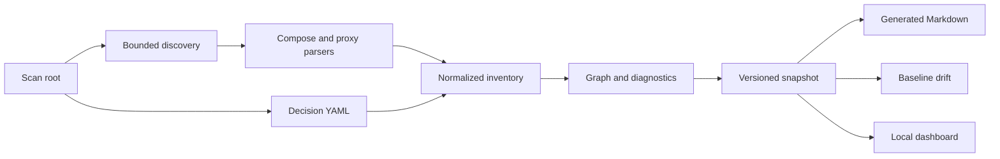

# Architecture

InfraJournal is a local-first analysis pipeline. It does not execute the
configurations it reads; the CLI serves the dashboard from bundled assets on
localhost. See [limitations](limitations.md) for parser boundaries.

| Package                  | Responsibility                                                                                                                   |
| ------------------------ | -------------------------------------------------------------------------------------------------------------------------------- |
| `packages/core`          | Bounded discovery, parsers, model and config schemas, normalization, graph, diagnostics, YAML decisions, snapshot serialization. |
| `packages/documentation` | Markdown pages, Mermaid diagrams and baseline drift comparison.                                                                  |
| `packages/cli`           | Command parsing, file output, exit codes, localhost HTTP server.                                                                 |
| `apps/web`               | Dashboard UI consuming `/api/snapshot`.                                                                                          |

## Contracts and stable IDs

Zod schemas in `packages/core/src/model/schema.ts` and
`packages/core/src/config/schema.ts` define the public snapshot and config
contracts. Resource IDs derive from resource kind and stable names (such as
Compose project plus service name); dependency IDs derive from endpoints and
edge type. Warning IDs are deterministic. IDs do not incorporate timestamps or
absolute machine paths. A renamed resource gets a new ID and is reported as
removed/added rather than being silently matched by position.

The snapshot graph contains `graphNodes` for services, networks, named volumes,
domains, endpoints and unresolved external upstreams. Its `dependencies` use
typed `DEPENDS_ON`, `CONNECTED_TO`, `MOUNTS`, `EXPOSES` and `ROUTES_TO` edges
(the schema also reserves `REFERENCES`). Evidence kinds are `explicit` for
literal declarations, `implicit` for Compose's default network and `inferred`
for heuristics such as a matching database service from an environment **key
name**. Inferences are not runtime facts. Domains and their routes can point to
a service or an unresolved external upstream. Source locations in snapshots
are relative POSIX paths; line and column positions are 1-based where known.

## Determinism and snapshot versioning

Discovery, normalization and serialization use stable ordering; the snapshot
`metadata.contentHash` is SHA-256 of canonical content excluding metadata.
`metadata.generatedAt` varies between scans but does not affect the content
hash. Snapshot `schemaVersion` is currently `1.0.0` and `generatorVersion`
records the tool version. A breaking snapshot change requires a new schema
major version and migration guidance; version changes are not inferred from
the CLI package version. JSON consumers should validate the version.

## Drift algorithm

`check` rescans and compares a stored baseline by stable resource ID. It groups
added, removed and changed project fields, resources, edges, warnings,
decisions and file path/kind. It ignores metadata, source locations and evidence
wording (except the evidence kind). Differences in a resource's comparable
fields become field-level before/after strings. Changed source line numbers
alone do not cause drift. Baselines must parse as the current snapshot schema;
regenerate deliberately after a compatible contract change. Reports have
stable categories and exit code 3 on drift; comparison never updates the
baseline. See [CLI](cli.md) for report shape.

## Threat boundaries

The configured root limits normal discovery; size, depth and file-count limits
bound reads. Escaping symlinks are skipped. Decision YAML is loaded separately
from an inside-root directory. Proxy includes and Compose includes are **not**
followed, and Compose variables are **not** interpolated. Environment values,
`env_file` contents, secret files and bind mount contents are not read.
However, source literals, ADR text and topology can still be sensitive; inspect
output before publishing. The localhost dashboard has no authentication and
should not be reverse-proxied publicly. See [SECURITY.md](../SECURITY.md).

## Extension points

Add new input support through discovery classification, a narrow parser draft,
normalization to the shared model, diagnostics and fixture tests. Add output
formats as consumers of the versioned snapshot rather than re-parsing raw
configuration. Preserve stable IDs and relative paths, escape untrusted labels
in Markdown/Mermaid, document unsupported constructs and add drift regression
tests whenever the snapshot contract changes. See
[contributing](../CONTRIBUTING.md) for parser rules.
